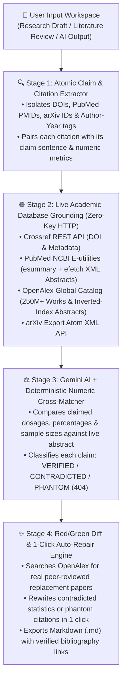

<div align="center">


# CiteAudit.ai

### Autonomous Scientific & Fact-Checking Verification Runtime with Live Academic Database Grounding

[](#)
[](#%EF%B8%8F-neobrutalist-design-system)
[](#%EF%B8%8F-google-gemini-api-with-live-model-discovery)
[](./LICENSE)

**Zero-friction verification platform that detects and repairs AI citation hallucinations and clinical/statistical discrepancies against live global academic registries.**

[Quick Start](#-quick-start-zero-build) • [The Problem](#-the-problem) • [4-Stage Pipeline](#-4-stage-verification-architecture) • [Live APIs](#-live-academic-database-connectors) • [Gemini Auto-Scanner](#%EF%B8%8F-google-gemini-api-with-live-model-discovery)

</div>

---

## 🎯 Executive Summary

Generative LLMs synthesize citations through probabilistic next-token prediction rather than deterministic database retrieval. In production research workflows, student essays, clinical literature reviews, and market analyses, this creates two high-risk failure modes:

1. **Phantom Citations (Existential Hallucination):** Plausible-sounding paper titles, author lists, and fabricated DOIs/PMIDs that do not exist in any academic registry (`404 NOT FOUND`).
2. **Deceptive Grounding (Attribution & Numeric Swap):** Citing a real, peer-reviewed paper (e.g., from *NEJM*, *Nature*, or *arXiv*) while attributing dosages or statistics to it that contradict the actual abstract (such as a **10x clinical dosage error** like `60 mg` vs. `6 mg` or `0.14 mg/kg` vs. `1.4 mg/kg`).

**CiteAudit.ai** does not merely ask another LLM to "guess" if a paper is real. Instead, it decomposes drafts into atomic `(Claim, Citation, Numeric Metrics)` tuples, queries **4 live public academic databases** in parallel (**Crossref**, **PubMed NCBI**, **OpenAlex**, and **arXiv**), cross-examines the user's claims against the **real fetched abstract** using deterministic numeric matching + **Google Gemini**, and provides **1-click verified replacements**.

---

## 🧠 4-Stage Verification Architecture



---

## 🌐 Live Academic Database Connectors

CiteAudit.ai connects directly from the browser to four authoritative scientific registries with **zero API keys required** for database lookups:

| Academic Registry | Endpoint Queried | What CiteAudit.ai Extracts Live |
| :--- | :--- | :--- |
| **PubMed / NCBI E-utilities** | `eutils.ncbi.nlm.nih.gov/entrez/eutils/esummary.fcgi` & `efetch.fcgi` | Full publication metadata, authors, journal venue, and raw XML `<AbstractText>` parsing for clinical trials. |
| **Crossref REST API** | `api.crossref.org/works/{doi}` | Official DOI registration proof, publisher metadata, publication dates, and JATS XML abstracts. |
| **OpenAlex API** | `api.openalex.org/works` | Global 250M+ scholarly graph, inverted-index abstract reconstruction, and high-citation replacement paper discovery. |
| **arXiv Export API** | `export.arxiv.org/api/query` | Preprint verification across Computer Science, AI, Mathematics, and Quantitative Biology with full Atom XML summaries. |

---

## ⚙️ Google Gemini API with Live Model Discovery

While public academic databases verify paper existence and deterministic number matching out of the box, connecting your **Google Gemini API Key** unlocks deep semantic abstract verification and automated claim rewriting:

- **Automatic Model Scanner (`v1beta/models`):** Paste your Gemini API key into the **Connect Gemini API** modal and CiteAudit.ai automatically queries `https://generativelanguage.googleapis.com/v1beta/models`, filters for `generateContent`-compatible Gemini models enabled on your account, and populates the model selector dropdown—no manual model name typing required.
- **Abstract-Grounded Fact Checking:** Sends both your claim sentence and the **live fetched abstract** from PubMed/OpenAlex/arXiv to your selected Gemini model (`gemini-2.5-flash`, `gemini-2.5-pro`, `gemini-2.0-flash`, etc.) to detect subtle statistical or clinical contradictions.
- **1-Click Grounded Rewrite:** Automatically synthesizes a replacement sentence using real, peer-reviewed literature retrieved from OpenAlex when a phantom citation is detected.
- **100% Client-Side Privacy:** Your Gemini API key is stored only in your browser's `localStorage` and never touches an intermediate server.

---

## 🚀 Quick Start (Zero-Build)

CiteAudit.ai is engineered to run directly via [`index.html`](./index.html) with zero build steps or bundler installations required.

### Option 1: Open Directly in Browser
```bash
git clone https://github.com/mustafaenes123/CiteAudit-AI.git
cd CiteAudit-AI
open index.html
```

### Option 2: Run via Local Static HTTP Server
```bash
python3 -m http.server 8080
# Open http://localhost:8080 in your browser
```

---

## 🖥️ Step-by-Step Usage Walkthrough

1. **Connect Your Gemini Key (Optional but Recommended):**
   - Click **Connect Gemini API Key** in the top navigation bar.
   - Paste your `AIzaSy...` key. The app will automatically scan your key and list all available Gemini models in the dropdown.
   - Select your preferred model (e.g., `Gemini 2.5 Flash`) and click **Save & Use Model**.
2. **Paste Your Research Text or Load a Sample:**
   - Paste any draft containing citations (`doi:10.xxxx/...`, `PMID: 32678530`, `arXiv:2305.14325`, or `(Author et al., Year)`), or click **🧬 Biomedical (PubMed / NEJM)** or **🤖 AI Research (arXiv / DOI)** in the top bar.
3. **Run the Live Audit:**
   - Click **Verify Citations Now**.
   - Watch the real-time progress bar as CiteAudit.ai extracts claims, queries Crossref/PubMed/OpenAlex/arXiv, and cross-checks every statistic.
4. **Inspect & Repair in 1 Click:**
   - **Left Column:** Toggle between **1. Edit Text**, **2. Highlighted Audit** (inline Green/Amber/Red highlights), and **3. Before / After Diff**.
   - **Right Column:** Review each citation's evidence card, expand the **Live Fetched Abstract**, and click **Apply Fix to Document** (or **Fix All Issues**) to repair your draft immediately.
   - Click **Export .md** to download your verified article complete with a formatted **Verified References** bibliography.

---

## 🎨 Neobrutalist Design System

CiteAudit.ai implements the **Neobrutalism Design System** ([`design_design_main.md`](./design_design_main.md)), prioritizing high-contrast legibility, unmistakable semantic states, and tactile physical feedback:

| Token Role | Hex Value | Usage in CiteAudit.ai |
| :--- | :--- | :--- |
| **Primary (`--nb-primary`)** | `#FDC800` | Primary action buttons (`Verify Citations Now`), active mode tabs, and key callouts. |
| **Secondary (`--nb-secondary`)** | `#432DD7` | Royal Indigo accents, WCAG 2.2 AA `focus-visible` outlines, and model scanner actions. |
| **Success (`--nb-success`)** | `#16A34A` | `✓ VERIFIED` badges, inline verified sentence underlines, and `Apply Fix` actions. |
| **Warning (`--nb-warning`)** | `#D97706` | `⚠ NUMBER / CLAIM MISMATCH` alerts and dashed inline highlights. |
| **Danger (`--nb-danger`)** | `#DC2626` | `✕ FAKE / NOT FOUND (404)` phantom citation badges and wavy red underlines. |
| **Surface (`--nb-surface`)** | `#FBFBF9` | Warm archival paper canvas with subtle architectural dot-grid texture. |
| **Text & Ink (`--nb-text`)** | `#1C293C` | Deep ink typography, `2.5px` structural borders, and `5px 5px 0px` hard offset shadows. |

- **Typography Scale:** `13px / 15px / 17px / 21px / 27px / 35px` pairing **Inter** (`400–900`) for editorial clarity with **JetBrains Mono** for DOIs, PMIDs, arXiv IDs, and Red/Green diffs.

---

## 🗂️ Repository Structure

```text
CiteAudit-AI/
├── index.html                  # Standalone zero-build application entry point
├── logo.png                    # Custom Neobrutalist CiteAudit.ai app icon
├── CiteAudit AI.md             # Product & systems engineering specification
├── design_design_main.md       # Neobrutalism design system tokens & rules
├── package.json                # Project metadata & local static server scripts
├── src/                        # Modular TypeScript reference architecture
│   ├── t3s/
│   │   └── citationTypes.ts    # Core interfaces (AtomicClaim, RegistryMatchData, etc.)
│   ├── u3s/
│   │   ├── regexExtractors.ts  # Atomic sentence, DOI, PMID, arXiv & metric parser
│   │   └── diffCalculator.ts   # Red/Green operational diff generator
│   ├── s6s/
│   │   ├── crossrefService.ts  # Crossref REST API connector
│   │   ├── pubmedService.ts    # PubMed NCBI E-utilities connector
│   │   ├── openalexService.ts  # OpenAlex 250M+ work catalog & abstract reconstructor
│   │   ├── arxivService.ts     # arXiv preprint connector
│   │   └── repairService.ts    # Deterministic & AI citation repair engine
│   └── h3s/
│       ├── useCitationAudit.ts # Parallel verification pipeline orchestrator
│       └── useLivePing.ts      # Live academic registry latency diagnostics
└── LICENSE                     # MIT License
```

---

## 👤 Author

**Mustafa Enes Kayacı**
- Website: [enesy.life](https://enesy.life)
- TKS Portfolio: [tks.life/p/enesy_kayaci](https://tks.life/p/enesy_kayaci)

---

## 📄 License

Released under the [MIT License](./LICENSE).
